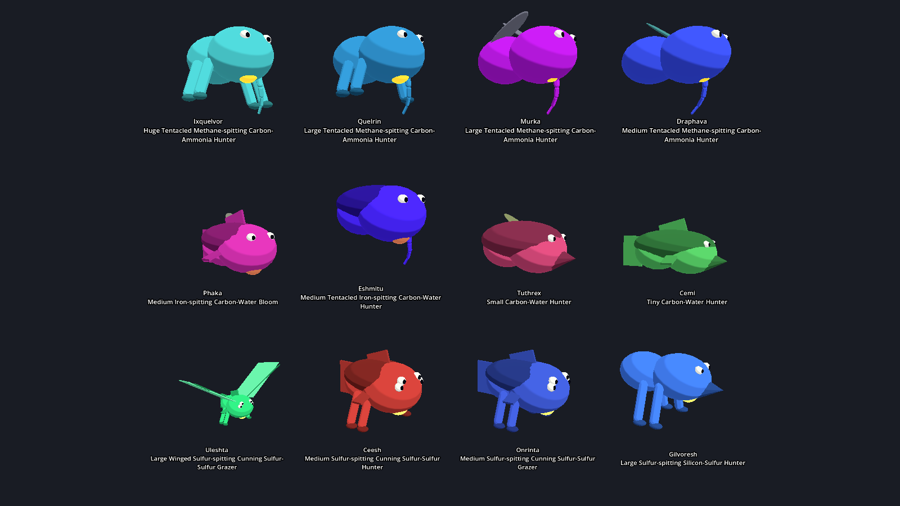
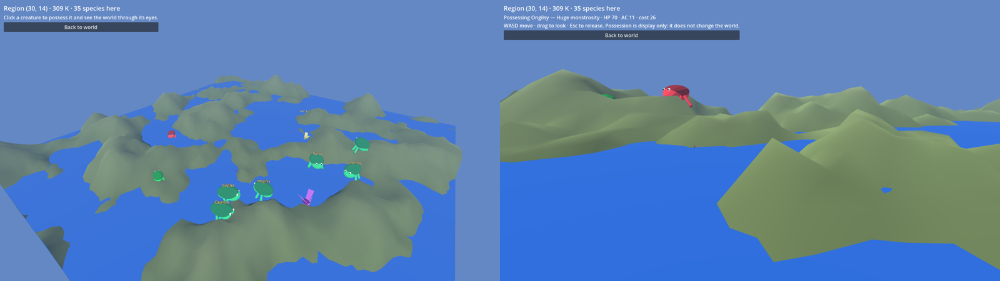
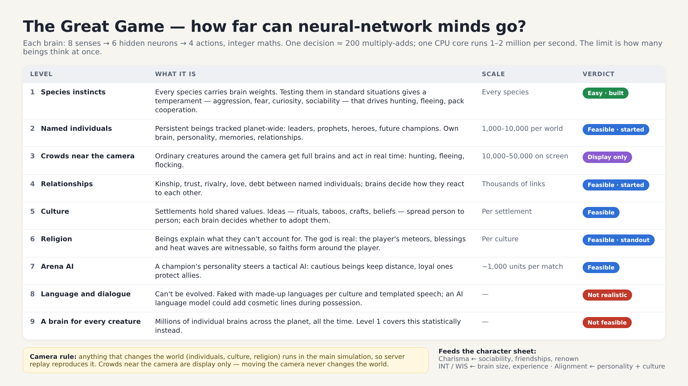
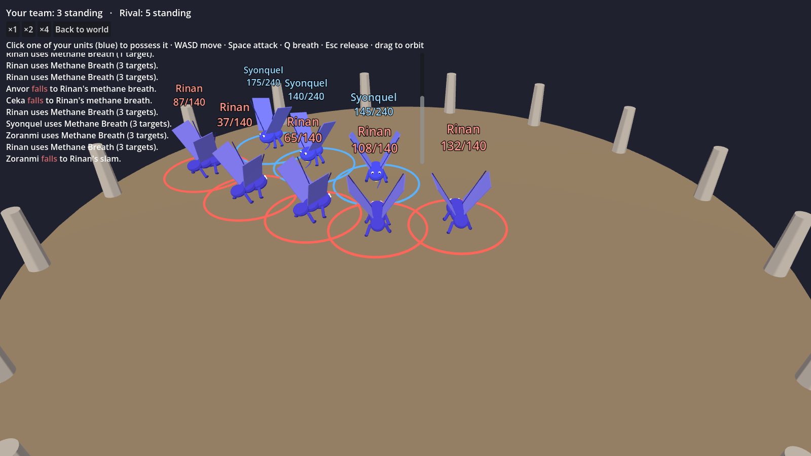
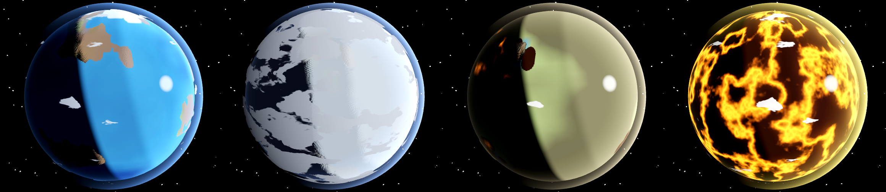
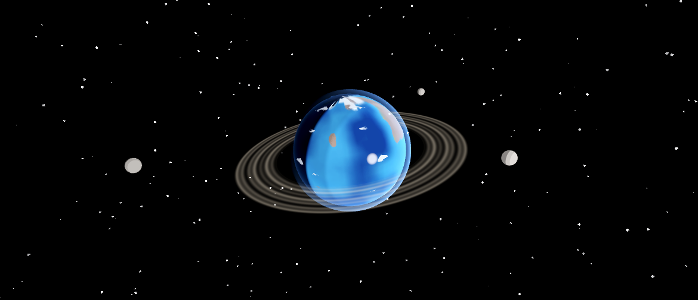

# The Great Game — Game Design Document (Draft v0.2)

> Status: living document. Sections marked **[OPEN]** need a decision before production on that system starts.

## 1. Product Summary

- **Genre:** God-game / evolution sandbox + competitive arena battler.
- **Platform:** Standalone downloadable PC game (Windows first, then Linux/Steam Deck, macOS). **Decided:** macOS development and testing are paused for now; CI covers Windows and Linux. Distributed on Steam and similar storefronts. Not a browser game.
- **Art style:** stylised, in the spirit of World of Warcraft: exaggerated proportions, bold silhouettes, hand-painted textures, saturated colour. This suits procedural creatures of unknown anatomy, keeps large battles cheap to render, and fits Godot's renderer.
- **Fantasy:** You are the architect of a world. You seed it with matter, tune its physics and metaphysics, and watch life emerge in whatever form your rules allow. Then you take the best of what your world produced and send it to fight the creations of other gods.

## 2. Core Pillars

1. **Craft an evolving world.** Start from a blank petri dish. Add elements and molecules, tune temperature and conditions, and grow a biosphere. Viewed from on high.
2. **Write the laws of reality.** As life develops, define the rules: magic systems, physical laws, the power of the soul, Daoist cultivation, and more. Sapient life is possible, not guaranteed. Sapient species form civilizations, laws, and relationships. The player can possess any being and enter the world in first person.
3. **Life is not limited to carbon and water.** The simulation extrapolates life from whatever chemistry and metaphysics the world contains: classical fantasy creatures (goblins, dragons) and alien ones (hydrogen-silica goo demons) alike.
4. **Every being has a character sheet.** Beings receive stats in a D&D 5th-edition-style format and a **cost from 1 to 1000** based on stats, innate abilities, and equipment.
5. **Champions fight online.** Players draft champions from their own world into a team under a fixed total cost cap and control them directly in an online arena, using their innate abilities. Team size is limited only by the cost cap. **Death in the arena is permanent.**

## 3. Core Loop

```
 ┌──────────────── WORLD (single-player, long session) ────────────────┐
 │ Seed matter → tune environment → life emerges → set laws            │
 │      ↑                                              ↓               │
 │ spend Essence on new elements/laws ← observe, possess, intervene    │
 └───────────────────────────────┬─────────────────────────────────────┘
                                 │ "Bind" a being as a champion
                                 ▼
 ┌──────────────── ARENA (multiplayer, short session) ─────────────────┐
 │ Build roster under cost cap → match → real-time battle → results    │
 │      ↑                                                   ↓          │
 │ adjust roster ← earn Essence / cosmetics / ranking ←─────┘          │
 └─────────────────────────────────────────────────────────────────────┘
```

- **Essence** (working name) is the bridge currency. **Decided:** every world starts with a free set of basic resources. Players earn Essence by defeating other players in the arena and spend it to add extra and new resources beyond the basics.
- Essence cannot be bought with real money (see §9). Paid Essence would be pay-to-win in a competitive game with permadeath.
- **Essence economy (decided):**
  - **Earning:** a player earns **500 Essence per ranked win**.
  - **Selling war spoils:** each spoil of war (a loot grant, §6.2a) has a pseudo-cost: the fallen champion's cost (1–1000). Instead of bringing a spoil home, the winner may sell it back to the server at 1:1 for that much Essence. The server then deletes the grant, so it can never enter a world.
  - **Shop:**

    | Item | Price | What it gives |
    |---|---|---|
    | Heavy metals (gold, tungsten) | 1,000 | A deposit placed in one region of a world |
    | Rare earths | 2,000 | A deposit placed in one region of a world |
    | Radioactive elements (uranium, thorium) | 3,000 | A deposit placed in one region of a world |
    | Extra moon | 10,000 | One more moon slot for one world (every world has one free slot) |
    | Extra planet | 50,000 | One more home world for the player's army roster |

  - Purchases arrive as server-signed grants, like loot. The server checks them when it replays a world log (§6.2), so a world cannot hold more moons or bought elements than its owner paid for. Each extra planet is a separate world with its own seed and log. The server registers each world a player binds champions from, up to their number of planet slots.
  - Element prices (decided): heavy metals 1,000, rare earths 2,000, radioactive elements 3,000 per deposit.
  - **Built:**
    - **Shop elements:** gold and tungsten (heavy metals), rare earths, and uranium and thorium (radioactive). The free tools cannot add them, only remove them. A deposit adds 2 units to each region within 2 of the chosen spot, on the planet or on a moon.
    - **Tungsten** can be forged like iron, so peoples without iron reach the Forging era. It is the best gear material (grade 4).
    - **Gold** carries enchantments: magic traditions with gold enchant their gear one arcana level sooner, and their spell foci gain +1 to hit.
    - **Rare earths** make a people learn 30% faster.
    - **Uranium and thorium** warm the ground (8 K per unit, up to 10 units) and feed heat-eating life. They also irradiate the life around them (3% extra death per unit, armour shields) and speed up its mutation (+20% speciation per unit).
    - **Server:**
      - It pays 500 Essence per ranked win.
      - It records each spoil's value (the fallen champion's cost) and buys spoils back 1:1. A sold spoil can never enter a world, and a spoil already brought home cannot be sold.
      - It sells deposits, moon slots and planet slots.
      - It refuses a world whose purchases it never made, that belong to another player, or that were used twice or in another world.
      - Each account binds champions from at most 1 + extra planets home worlds.
      - It keeps every spoil and purchase not yet used in a world and sends them again at sign-in, so nothing won or bought is lost if a reply never arrives.
    - **Client:**
      - After a ranked win, each spoil offers "Bring home" or "Sell for N Essence". Undecided spoils wait in the arena's online panel.
      - The shop lists every item, with Buy buttons enabled when the player can afford them. A bought moon slot is added to the planet at once. A bought deposit waits until the player places it at the selected region of the planet or moon in view.
      - The free substance tool lists shop elements greyed out, as "(buy with Essence)".
- **Snowball risk:** winners earn Essence and loot (§6.2a), which makes them stronger. Losers get nothing. Mitigations to test: rating-based matchmaking keeps opponents close in strength; diminishing Essence and loot value from repeat wins against much weaker players.

## 4. World Simulation

### 4.1 Simulation Layers (Level of Detail)

A full atom-level simulation of a planet is not feasible. The world runs at several fidelity levels at once and promotes detail only where the camera or a possessed being is.

| Layer | Scale | What it simulates | Tick rate |
|---|---|---|---|
| L0 Planetary | Whole world | Climate bands, atmosphere composition, ocean/solvent coverage, energy budget | Once per sim-year |
| L1 Regional | Hex/voxel regions (~10–100 km) | Chemistry pools, biomes, species populations, migration, civilizations | Once per sim-season |
| L2 Local | Area around camera (~1 km) | Individual creatures, ecology interactions, settlements | Real time when observed |
| L3 Embodied | Around possessed being | Full first-person gameplay, physics, combat | 60 Hz |

Rule: lower layers are the source of truth. Higher-detail layers are generated from them deterministically (seeded) and write back aggregate changes only.

### 4.2 Chemistry Model

Elements and molecules are data, not code. Each substance defines properties the life model can reason about:

- Phase transition temperatures (melting, boiling) at a given pressure.
- Bonding capacity (valence) and bond energy, for whether it can form long chains.
- Solvent quality (polarity, liquid range).
- Reactivity and energy release (as fuel or oxidizer).
- Optional **metaphysical properties** once laws allow them (mana conductivity, soul resonance, qi density).

The player adds substances to regions and adjusts temperature, pressure, and radiation. The L0/L1 simulation resolves which substances are solid, liquid, or gas and which reactions occur.

### 4.3 Life Viability: the "Life Triad"

Life can emerge in a region when three requirements are met. Each one has many possible answers:

1. **Backbone** — something that forms complex, stable structures. Carbon chains, silicon lattices, crystalline mana matrices, plasma knots, bound souls.
2. **Medium** — something that lets the components move and interact. Water, ammonia, methane, liquid sulfur, molten silicate, ambient mana.
3. **Energy gradient** — something to feed on. Sunlight, geothermal heat, chemical redox, radiation, ley lines, worship.

Each triad combination produces a **Biochemistry Profile**. The profile constrains everything downstream: temperature tolerance, metabolism speed, size limits, lifespan, natural weapons, and what counts as food or poison. Hydrogen-silica goo demons are one profile; oxygen-water mammals are another. New profiles appear automatically when the player adds new substances or laws, with no hand-authored list required.

### 4.4 Evolution

- Unit of simulation is the **species population** in a region (L1), not the individual.
- Each species has a **genome**, bounded by its Biochemistry Profile, with three parts:
  - **Physiology:** size, temperature preference and tolerance, fecundity, metabolism.
  - **Body-part genome:** a list of parts (segments, shells, fins, fronds, eyes, jaws, brains, tentacles, limbs, claws, wings, glands), each with a count and size. Glands carry a substance from the local chemistry, which later sets their breath weapon or venom. Armour, speed, intelligence and offence are derived from the parts, never set directly.
  - **Brain genome:** a small neural network (§4.8).
- **Evolutionary milestones** gate which parts a lineage can grow. Each needs its predecessors plus suitable conditions in the world:

  | Milestone | Requires | Condition | Unlocks |
  |---|---|---|---|
  | Multicellularity | — | Dense, well-fed population | Segments, shells, fins, fronds; size above microscopic |
  | Nervous system | Multicellularity | — | Eyes, jaws, brains, tentacles; behaviour (§4.8) |
  | Skeleton | Multicellularity | Enough structural material in the local chemistry | Large bodies |
  | Chemical glands | Multicellularity | A reactive substance in the region | Glands |
  | Limbs | Skeleton + nervous system | — | Limbs, claws |
  | Flight | Limbs | Gravity ≤ 2 g, pressure ≥ 0.15 bar | Wings |
  | Sapience | Nervous system | High intelligence, manipulators (limbs or tentacles), sociable temperament | Named civilisations (later phases) |

- Each sim-season: fitness is scored against region conditions and competing species; populations grow or shrink; species compete within size niches and hunt much smaller species; genomes mutate; populations speciate.
- **Food chain (decided):** life is split into producers and animals.
  - **Producers** are species without a nervous system: plants and microbes. They live directly on light, heat or chemistry, and compete only with other producers.
  - **Animals** have a nervous system and get little energy directly: one tenth of a producer's share, plus a bit more for each light-catching frond. They compete only with other animals of similar size. They live by eating:
    - **Grazing:** animals of every size share one pasture in each region. The food on offer is the producers' standing crop, or a share of what the producers there could grow, whichever is larger. The second option means heat- and chemistry-fed worlds can feed animals too. Each animal species gets a slice of the pasture in proportion to how much it grazes (hunters graze little) and how well it lives there. Grazing removes at most a quarter of a region's plants each season.
    - **Hunting:** predators eat much smaller animals, as before.
  - Names follow the role: a mindless multicellular light-feeder is a *Plant* (a *Bloom* if it has leaves); an animal that does not hunt is a *Grazer*.
  - Measured in the prototype at year 1,000 on Earth-like worlds (8 seeds):
    - Standing plant biomass is about equal to animal biomass. Before this change it was about 1:20.
    - Every seed still reaches sapience, between years 200 and 600.
    - On the frozen moon, animals now live on chemistry-fed producers, and seed 1 still founds a civilisation by year 800.
- **Humanoid bias (decided):** sapience pulls bodies toward a humanoid plan: four limbs (two legs, two arms), two eyes, at most two body segments, and no fins or tentacles.
  - Each step happens with some chance:
    - when a species becomes sapient
    - in each offspring of a sapient lineage
    - as a slow drift of living sapient peoples, about one step a decade
  - Wings and leaves are lost more slowly, so winged or leafy peoples remain possible.
  - Lineages without the Limbs milestone (for example tentacled peoples) keep their own plan.
  - In the prototype, most sapient species (37 of 41 in one measurement) are humanoid by year 1,000.
  - The viewer builds humanoids upright, and builds plants as rooted, swaying stems, trunks or kelp that cannot be possessed.
- **Sapience rule (decided):** an unmodified, stable Earth-like world should produce sapient life almost every time, given enough time. Worlds that never reach sapience should be the result of unusual player choices (exotic chemistry, broken orbital dynamics, harsh laws), not the basic Earth template.
- How the simulation achieves this:
  - **Feedback loop:** as with hands, social life and brains on Earth, lineages with manipulators (limbs or tentacles) and a sociable temperament grow brains faster, and clever, social tool-users compete better.
  - **Awakening:** a species that is clever, social and has manipulators can become sapient in any season, not only when a new species splits off.
  - **Competitive exclusion:** each sapient species already alive makes further awakenings less likely, and sapient lineages split into new species far less often. A world ends up with a handful of sapient peoples, not hundreds. That suits fantasy settings with several peoples (elves, dwarves, goblins).
- Pace (Phase 0.5 prototype, Earth-like world): multicellular life within about 100 years, nervous systems and skeletons within about 300, sapience usually within about 500–1,000 years (all 8 test seeds by year 1,000), limbs and flight within about 1,000.
- **Body Plan Synthesis:** the body-part genome maps to a procedural body plan (skeleton/topology, locomotion, surface material) for rendering and animation.
  - **Prototype (Phase 2):** `game-client/creature_builder.gd` assembles a stylised model from the parts list: segments become a chain of rounded body blobs (the head grows with brain size), eyes sit in pairs on the head, jaws form a snout, shells form a dome, fronds splay from the back, limbs attach in pairs with claws on the front feet, fins become dorsal, side and tail fins, wings become flapping sails, tentacles become waving chains, and glands become a glowing throat sac in their substance's colour. Single cells are pulsing blobs with a whip tail. Procedural animation walks the legs, flaps the wings and waves tentacles and tails. Final art will replace the primitive shapes with an artist-made parts kit using the same attachment rules.


- **Archetype Matcher:** trait vectors near a known fantasy archetype receive that archetype's name, silhouette hints, and signature ability. Example: large + flight + reptilian + exothermic gland → "Dragon" with a breath weapon whose damage type comes from the gland's chemistry. Beings that match no archetype get a generated name. This is how classical monsters and true aliens coexist.
  - **Built (`sim-core/src/archetype.rs`):** archetypes are checked from the most specific to the most general, and the first that fits wins. Its name shows on the sheet ("Archetype: Dragon"), and its signature ability changes the sheet, so the cost follows.
    - **Monsters:**
      - Dragon (Frightful Presence)
      - Phoenix (fire immunity, regeneration)
      - Wyvern and Giant Spider (venom attacks)
      - Hydra (a bite per head, regeneration)
      - Kraken, Sea Serpent and Behemoth (crushing attacks; the Behemoth also resists blunt weapons)
      - Roc and Griffin (talon or pounce attacks)
      - Golem (+2 AC, resists weapons)
      - Basilisk (petrifying gaze, which frightens)
      - Treant (resists weapons, regenerates, vulnerable to fire)
      - Beholder (eye rays)
      - Star Spawn (necrotic touch)
    - **Peoples:**
      - Giant (Rock Throw)
      - Mind Flayer (Mind Blast)
      - Merfolk (swim speed)
      - Aarakocra (Dive Strike)
      - Goblin (+1 AC)
      - Gnome (resists psychic)
      - Dwarf (resists poison)
      - Orc (extra hit points)
      - Elf (+1 to hit with weapons, darkvision)
      - Human (no ability yet)
    - Measured over 3,932 species (4 presets × 3 seeds, year 1000): about 4% match an archetype. The rest stay alien.
    - Silhouette hints for the final art kit come with the art.

### 4.4a Extradimensional Beings

Not all life has to come from the world's own chemistry. Some beings come from outside reality: Lovecraftian, extradimensional entities that do not follow the life triad at all.

- **The Veil:** a measure of how separate the world is from whatever lies beyond. Each region has a Veil strength; where it is thin, things can come through.
- **What thins the Veil (proposed):**
  - **Player laws:** a "Veil" setting among the metaphysical laws, from sealed to wide open. Exotic Veil-thinning resources can be unlocked with Essence.
  - **Extreme physics:** strong gravity wells, frequent eclipses from many moons, and Godhand-mode settings that break real physics all strain reality.
  - **Metaphysics:** mana convergence (Arcane Magic), mass deaths releasing souls (Soul Power), and cultivators breaking through to higher realms.
  - **Minds:** sapient cultures whose religions reach outwards (§4.8, level 6). Worship can call things in.
- **Biology without chemistry:** extradimensional beings need no backbone, medium or energy gradient. They feed on what the world's minds and metaphysics produce: thought, fear, souls, mana. In the population simulation, they draw energy from nearby species with nervous systems and raise those species' fear, rather than eating biomass.
- **Bodies:** their own body-part set, not bound by gravity or the square-cube law: impossible geometry, phase membranes that exist partly elsewhere, eye clusters, tendrils, voids. They ignore normal size caps.
- **Minds:** alien brains with extra senses and outputs. Their temperament may read as incoherent to the world's creatures. They can become named individuals. Their presence warps relationships: cults form around them, and they compete with the player as objects of worship.
- **Character sheet:** type Aberration. Typical traits: psychic damage, Frightened and madness effects, truesight, telepathy, resistance to non-magical damage. Usually high cost.
- **Risk and reward:** a world with a thin Veil can produce the strongest champions in the game, but the entities can destabilise or consume the world's own life. They can arrive uninvited if the player creates the right conditions, so world-building choices have consequences.
- **Naming:** all entities get original generated names. No names from commercial mythos products.
- **Physics alone is enough (decided):** extreme enough physics can thin the Veil even in a world with no metaphysical laws at all. A purely physical world is safer, not immune.
- **Implemented (prototype):**
  - *Veil strength:* each region has a Veil from 0 (wide open) to 1 (sealed). It moves 20% of the way toward its target each season.
  - *Planet-wide thinning:*
    - The Veil law: 0–100% open, worth up to 0.8.
    - Reality strain (§4.6) s: worth 0.8 × s / (s + 3).
    - Eclipses: 0.05 per moon beyond the second, up to 0.3.
  - *Local variation:* seeded fault lines give each region from 0.7× to 1.3× the planet-wide thinning. Beings already through hold their region open by a further 0.1.
  - *Breaches:* each region below 0.5 adds to the breach chance per season: 0.0002 × (0.5 − Veil), at most 25% for the planet. Thinner regions are likelier breach points.
  - *New kinds:* a breach brings a new kind of being, up to 8 kinds alive at once. After that, more of an existing kind comes through.
  - *Physics alone:* a Natural neutron star thins the Veil to about 0.6–0.8 but it holds. Godhand settings that break physics (for example, a neutron star shining like the Sun) open it.
  - *Bodies:* new parts no native lineage can evolve:
    - Eye clusters (2–8 eyes).
    - Tendrils.
    - Phase membranes (armour, +2 AC).
    - Voids (offence).
    - Sometimes jaws.
    - Size from half to about 40× human, beyond native size caps. Bodies are random, with alien brains wired at random.
  - *Feeding:* they ignore the life triad and temperature. Carrying capacity per region is 0.5 × the biomass of nearby native minds (nervous-system species, weighted by intelligence), plus a little from the Veil itself (4 × openness²). Each season they drain native minds in proportion to their own biomass and hunting. They fade where the Veil is strong: death rate 0.03 + 0.25 × Veil².
  - *Spread and behaviour:* they spread toward minds and thin places, and do not speciate.
  - *Effect on native minds:*
    - Native individuals count them as a major threat and flee them.
    - Native individuals remember the first time they glimpse one.
    - The beings themselves can become named individuals.
    - At 100% open on an Earth-like world, native minds lose about 10% of their biomass to them within a century, and more after.
    - Sealing the Veil again makes them fade within about 50 years.
  - *Character sheet:*
    - Type Aberration, alignment "Unknowable".
    - Resistance to bludgeoning, piercing, slashing and psychic damage.
    - Truesight 60 ft. with 4+ eyes, otherwise darkvision 120 ft.; telepathy 120 ft.
    - Tendril attacks, plus a psychic Mind Lash. A void gives a Void Pulse (psychic, Wisdom save).
    - Maddening Presence: in the arena, enemies within 30 ft. must pass a Wisdom save each round or attack with disadvantage.
    - Higher Intelligence and Charisma than native creatures. They float, with walk and fly speeds.
  - *Viewer:* Veil overlay, Veil law slider, Veil readout, violet sky tint on the globe, and floating models with tendrils, voids and a shimmering membrane.
  - *Also thinning (with the metaphysical laws, §4.6):* ley-line convergence (Arcane Magic), mass deaths releasing souls (Soul Power) and cultivation breakthroughs (Daoist Cultivation).
  - *Not yet:* worship (religions, §4.8 level 6), cults, and Essence-unlocked Veil resources.

### 4.5 Sapience and Civilization

- Sapience is a threshold on the intelligence trait plus social and manipulator traits. Many worlds never cross it. That is a valid outcome.
- Sapient species run an agent-based civilization model at L1: settlements, technology or magic progression, resource use, culture values, diplomacy, war.
- At L2, individuals get names, relationships (kin, rivals, allies, mentors), and a personal history. These feed the champion's backstory when bound.

**Implemented (Phase 4, `sim-core/src/civ.rs`; numbers proposed, open to tuning):** civilizations update once a year.
- **Founding:** every sapient species with enough biomass founds a people. Its capital is where the species is most numerous.
- **Culture:** taken from the species' temperament.
  - Militarism comes from aggression, openness from curiosity, cohesion from sociability, and caution from fear.
  - Culture drives expansion, learning, diplomacy and war.
- **Settlements:**
  - Population follows the species' biomass in that region. A settlement is lost when the people leaves.
  - Each year a people may found a new settlement in a neighbouring region where it lives. The chance rises with openness, up to 40 settlements.
  - No two peoples share a region.
  - A people with no settlements left falls.
- **Technology:** progress grows with the square root of population and with openness.
  - It moves through six eras: Primitive, Tribal, Crafting, Forging, Classical and Industrial.
  - Forging and later need iron in the people's lands; without it a people stays at Crafting.
  - On an Earth-like world, Forging comes about 300 years after founding and Classical about 600.
- **Magic traditions:** under Arcane Magic, peoples living on ley lines develop Hedge Magic, then Rituals, then Arcane Schools, then High Magic. Spellcasting species learn twice as fast.
- **Home advantage:** a people is stronger where it has settled, +15% per era.
- **Diplomacy:**
  - Opinion between peoples within 3 regions of each other drifts with how alike their cultures are. It drifts lower between different species and between cautious peoples.
  - War can break out when opinion falls below −0.4 and the more martial side's militarism is above 0.35. Each year the chance is 10% × that militarism, so martial peoples fight often and peaceful ones never start a war. Wars end within 10 years.
  - Measured (Earth-like, 8 seeds, year 1000): every seed with more than one people had wars. Before this tuning, only 2 of 8 did: neighbours came to hate each other but rarely reached the old militarism threshold of 0.55.
  - Peace comes after at most 10 years, or earlier by chance.
- **War:** each year, the stronger side wins a battle; strength is population × era × militarism, with luck.
  - The loser's settlement nearest the winner loses 40% of its people.
  - A small settlement is taken over by a winner of the same species, or razed by one of a different species.
  - Individuals in the fighting remember it, which counts towards the Fighter class.
- **Schisms:** a fractious people (cohesion below 0.4) with 12 or more settlements may split. The far half becomes a new people with a drifted culture and bad blood with the old one.

### 4.6 Laws of Reality

**Decided launch set: planetary and physical controls.** The player controls these from the start:

| Control | Range / notes | What it drives |
|---|---|---|
| Temperature | Global baseline plus regional heat/cool tools | Phases of substances, biome bands, life triad viability |
| Planetary composition | Elements and molecules in crust, mantle, and oceans/solvents | Available backbones, minerals, volcanism, magnetic field |
| Atmospheric composition | Gases and their proportions, surface pressure | Breathable/usable gases, greenhouse effect, sky colour, flight viability |
| Gravity | Surface gravity multiplier | Maximum creature size, flight cost, atmosphere retention, mountain height |
| Rotation speed | Day length; optional axial tilt | Day/night cycle, temperature swings, wind patterns, seasons |
| Star distance and orbital speed | Distance from the star and orbital period | Energy received, year length, climate zones |
| Star properties | Star type and luminosity (suggested) | Light spectrum, radiation level, photosynthesis-style energy |
| Moons | Number of moons; each with mass, distance, and orbital speed | Tides, eclipses, night light, orbital stability, impact risk |

**Physics coupling:** in real physics, orbital period follows from distance and star mass, and gravity follows from planet mass and radius. Two modes are proposed:

- **Natural mode:** linked values update together. Unstable configurations (for example, moons too close or too many) degrade over time with visible consequences such as tidal breakup or moons colliding.
- **Godhand mode:** each value is set independently, which is physically impossible but fun. **Decided:** allowed in ranked worlds. Godhand worlds are hard to make viable: impossible settings cause harsh side effects (for example, extreme tidal stress, atmosphere loss, or runaway heating), so only skilled players get good results.

**Implemented so far (Phase 2):**
- **Day length:** days longer than Earth's add a day–night temperature swing (thick air holds heat overnight). Life must tolerate both the hot day and the cold night, so very slow-turning worlds are harder on life.
- **Axial tilt:** seasons. Each year one hemisphere warms while the other cools, then they swap; thick atmospheres damp the swing.
- **Moons:** each has a mass and a distance. Tides heat the planet (like Io's volcanoes) and add energy for life. A moon placed inside the Roche limit (0.3 Earth–Moon distances) is torn apart into rings. A world has one moon slot; more can be bought with Essence (§3).
- **Moon worlds (built):** every moon is a world of its own, simulated alongside its planet.
  - It has its own regions, chemistry, atmosphere, life, individuals, civilizations and laws. Every planet control works on it: substances, heat, gravity, radius, axial tilt, laws and the Veil. Its champions can join the player's army.
  - It stays a moon of its planet:
    - It shares the planet's star, distance and year, so the star controls are the planet's.
    - Its mass, set by its own gravity and radius controls, is the moon's mass for the planet's tides.
    - In Natural mode it is tidally locked: its day equals its orbital period, 27.3 days × √(distance³ / (planet mass + moon mass)), with distance in Earth–Moon distances and mass in Earth masses.
    - The planet raises tides on it. A locked moon flexes only a little: 5% of the planet's tidal pull (planet mass in lunar masses / distance³) heats it, as with Io.
    - The planet eclipses its sun for part of each orbit: the fraction is the planet's radius / (π × distance × 60.3 Earth radii). Eclipses dim its light and thin its Veil.
    - A moon cannot have moons of its own.
  - **Orbit:** the moon's distance is set from the planet. In Natural mode it stays between the Roche limit and the stable limit. If the stable limit shrinks, the moon is drawn in rather than lost, so a bought moon is never destroyed by a slider. In Godhand mode any distance is allowed, with strain as for any unstable moon.
  - The whole moon, its actions included, is stored in the planet's action log (as actions aimed at that moon). Replaying the planet replays its moons.
  - A new moon starts as a bare world (rock with no chemistry); the player gives it its own chemistry. Tidally locked moons have long days and big day–night swings, so living moons need a close orbit or thick air (a Mars-sized moon at half the Moon's distance, with Earth-like chemistry and extra nitrogen, fills with life within a few centuries).
  - Viewer: a "Viewing" selector switches every map, list and tool between the planet and each moon. Controls owned by the planet (star, mode, moons) grey out on a moon, and a locked day shows its month. The planet's moon list shows each moon's life and temperature, with an orbit control and a View button.
  - Champions can come from a moon: the arena roster lists them as "(Moon 1)", and the server verifies them by replaying the planet's log and looking in that moon's world.
- The globe shows the tilt, a spin rate that follows the day length, orbiting moons and rings.
- **Natural and Godhand modes** (new worlds start in Natural):
  - *Natural:* the planet has a mass and a radius, and gravity = mass / radius². Asking for a gravity changes the planet's mass instead. The star's brightness follows from its type and mass (main-sequence stars: L ∝ M^3.5); asking for a brightness picks the closest mass the star type allows. Year length follows Kepler: √(distance³ / star mass), and long years mean stronger seasons. Moons beyond the stable limit (about 1.95 Earth–Moon distances × distance in AU × ∛(planet mass / star mass)) escape.
  - *Godhand:* gravity, brightness and moons are set freely. The distance from what physics allows is the world's **strain**: |log₂(gravity / natural gravity)| + |log₂(brightness / natural brightness)| + ½ per moon beyond the stable limit, capped at 20. Strain bleeds the atmosphere away (0.4% per point per season, up to 5%) and adds 8 K of heat per point. Switching back to Natural snaps the values back to physics.
- **Star types:** eight types. Each sets the light quality for light-powered life, a harmful radiation level, and the sun's colour on the globe.

  | Star | Mass (suns) | Brightness | Light quality | Radiation | Notes |
  |---|---|---|---|---|---|
  | Red dwarf | 0.1–0.5 | 0.015 | 0.5 | 0.6 | Flares (5% per season) strip the atmosphere |
  | Orange dwarf | 0.5–0.8 | 0.25 | 0.85 | 0.2 | Steady; good home for life |
  | Yellow dwarf | 0.8–1.2 | 1 | 1 | 0.2 | Sun-like |
  | White star | 1.2–2.5 | 5 | 1 | 0.6 | |
  | Blue giant | 2.5–30 | 3000 | 0.9 | 2 | Planets must orbit far out |
  | Red giant | 0.8–3 | 300 | 0.6 | 0.3 | Dying star, not main sequence |
  | White dwarf | 0.5–1.3 | 0.002 | 0.7 | 0.5 | Only very close planets stay warm |
  | Neutron star | 1.4–2.1 | 0.0001 | 0.1 | 8 | Strains reality |

  Brightness is at the typical mass. Radiation is relative to the Sun's, and falls with distance squared. The atmosphere shields the surface: dose = flux / (1 + 2 × pressure in bar). A dose above 1 (an airless Earth's) harms life, with armour as a shield, and speeds up speciation through mutation.
- **Reality strain** (feeds the Veil, §4.4a): Godhand strain, +2 around a neutron star, and log₂(gravity / 5) above 5 g.
- **Eclipses:** every moon beyond the second thins the Veil (§4.4a). Eclipse visuals are not built yet.

Extra and exotic resources (rare elements, unusual molecules, more moons, unusual star types) are unlocked with Essence.

**Decided launch set: metaphysical laws.** Arcane Magic, Soul Power, and Daoist Cultivation ship at launch alongside the planetary controls. Divine Favour and further Altered Physics are post-launch candidates. Metaphysical laws are rule modules that change simulation equations and unlock new traits and abilities. Each law has tunable parameters.

| Law | Effect on simulation | Example parameters |
|---|---|---|
| Arcane Magic | Adds a mana field to regions; unlocks spellcasting traits | Mana density, casting cost, school weights |
| Soul Power | Beings accumulate soul strength over a lifetime; enables reincarnation and soul-based abilities | Soul persistence, inheritance rate |
| Daoist Cultivation | Individuals can advance through cultivation realms by absorbing qi; growth beyond species norm | Qi density, realm thresholds, tribulation risk |
| Divine Favour | Worship generates energy for the player and grants blessings | Faith decay, miracle cost |
| Altered Physics | Change speed of sound, heat flow, entropy rate beyond the launch controls | Multipliers within safe bounds |

Laws can stack. Their interactions are the main source of emergent variety.

**Implemented (launch laws, `sim-core/src/laws.rs`):** each law is a strength from 0 to 100% set in the Laws tab. With all three at 0 the world runs exactly as before (tested). The numbers below are proposed and open to tuning.

- **Arcane Magic** (parameter: mana density):
  - Mana lies along seeded ley lines, a smooth field that gathers in a few places.
  - Lineages with nervous systems can evolve a new milestone, **Spellcasting**, where mana is at least 0.2. Spellcasters are up to 1.5× stronger rivals and hunters where mana is high.
  - Their sheets gain Innate Spellcasting and a force-damage Mana Bolt.
  - Where ley lines converge (mana above 0.6) the Veil thins, by up to 0.32 at full strength: it thins but does not open on its own.
- **Soul Power** (parameter: soul persistence):
  - Named individuals' souls grow each season with the law and their renown, up to 10.
  - At death a soul persists with chance 0.8 × the law, and waits (up to 64 at once).
  - The next named individual born receives it with three quarters of its strength, a "born remembering a past life" memory and an Old Soul trait.
  - A strong soul adds hit points (Soul Ward), and resistance to necrotic damage from strength 3.
  - Mass deaths (5+ biomass lost in a region in a season) release souls and tear the Veil there.
- **Daoist Cultivation** (parameters: qi density, tribulation risk):
  - Qi is a seeded field, richest in high places.
  - Named individuals absorb it each season, faster when calm and bright; beasts barely can.
  - Reaching 2^realm qi triggers a breakthrough with a heavenly tribulation. The death chance is risk × (0.1 + 0.05 × realm), and risk defaults to 30%.
  - Nine realms, from Qi Condensation to Tribulation Transcendence. Each success adds a quarter to lifespan, renown, +2 STR/DEX/CON/WIS, more hit points, +½ AC per realm and a force-damage Qi Strike.
  - Every breakthrough strains the Veil where it happens.

### 4.7 Player Interaction (God Mode)

- Top-down orbital camera with smooth zoom from planet to ground level.
- Tools: add substance, heat/cool, adjust pressure, adjust orbit/rotation/gravity, add/remove moons, meteor/seed delivery, set law, accelerate time, bless/curse, observe (tracking overlays: population, chemistry, mana, civilizations).
- **Possession:** select any individual at L2 to drop into L3 first-person control. The creature's actual stats and abilities apply. Possession can be used for exploration, guiding a civilization, or testing a future champion.
  - **Prototype (Phase 2):** from the region inspector, **Visit this region** builds a ground-level scene from the region's simulated state: terrain with seas sized to its liquids (lava glows on hot worlds, ice whitens cold ones), sky tinted by the atmosphere, and creatures from its populations (more biomass, more creatures; swimmers stay in the water) with its named individuals labelled. Click one to possess it: first-person view from its eyes, WASD to move, drag to look, its character sheet in the HUD. Following the camera rule (§4.8), the visit is display only; a test checks the world's state hash is unchanged.



### 4.8 Minds: Neural Networks

Every being's behaviour comes from a small neural network in its genome: 8 senses (food, threat, prey, stranger, kin, hunger, injury, bias), 6 hidden neurons, 4 actions (approach, flee, attack, socialise). Brains use fixed-point maths, so they are as deterministic as the rest of the simulation and replay verification still works. One decision costs about 200 multiply-adds; one CPU core manages about 1–2 million per second.

Brains run at several levels, chosen so cost stays bounded:



(Source for the image: `images/neural-network-feasibility.html`.)


| Level | What runs | Scale | Where | Status |
|---|---|---|---|---|
| 1. Species instincts | Each species' brain is tested once in standard situations. The answers become its temperament (aggression, fear, curiosity, sociability), which drives hunting, fleeing, pack cooperation and migration in the population simulation. | Every species | Main simulation | Phase 0.5 |
| 2. Named individuals | Persistent beings with a personal variant of their species' brain, a personality, health, renown, relationships and memories. They act every season: travel, flee, fight, befriend. Deaths are mourned, and killers earn grudges. | About 300 now; target 1,000–10,000 | Main simulation | Phase 0.5 (groundwork) |
| 3. Crowds near the camera | Ordinary creatures around the camera get full brains and act in real time. | About 10,000–50,000 | Display only | Later |
| 4. Relationships | Bonds between individuals: kinship, trust, rivalry, love, debt. | Thousands of links | Main simulation | Phase 0.5 (affinity and kinship) |
| 5. Culture | Settlements hold shared values. Ideas (rituals, taboos, crafts, beliefs) spread person to person; each individual's brain decides whether to adopt them. | Per settlement | Main simulation | Later |
| 6. Religion | Beings explain events they cannot account for. The player's interventions are real, witnessable events, so religions can form around the player. Different cultures may read the same act differently. | Per culture | Main simulation | Later |
| 7. Arena AI | A champion's personality steers a tactical arena AI: cautious beings keep their distance, loyal ones protect allies. | About 1,000 units per match | Arena server | Later |
| 8. Language | Made-up languages per culture plus templated speech. An optional AI language model may add flavour lines during possession, as cosmetics only. | — | Display only | Later |

**Camera rule:** anything that affects the world (named individuals, relationships, culture, religion) runs in the main simulation, independent of the camera, so replay verification reproduces it. Crowds near the camera are display only: moving the camera must never change the world.

**Feeding the character sheet (§5):**
- **Charisma:** sociability, number of friendships, and renown. The prototype shows a CHA preview for named individuals.
- **Intelligence and Wisdom:** brain size and complexity, plus life experience for named individuals.
- **Alignment:** personality plus cultural values.
- **Backstory:** a named champion carries its real relationships, deeds and memories.

## 5. Character Sheets

### 5.1 Format

Every individual can produce a sheet in a 5e-compatible format:

- **Ability scores:** STR, DEX, CON, INT, WIS, CHA (1–30), with modifiers.
- Size, type (generated from archetype or biochemistry), alignment (derived from civilization/culture values, or "Unaligned").
- Armour Class, Hit Points (hit dice from size and CON), speeds (walk, fly, swim, burrow, climb).
- Proficiency bonus, saving throws, skills.
- Damage resistances, immunities, vulnerabilities, condition immunities: derived from biochemistry. A silica-based being might resist fire and be vulnerable to thunder.
- Senses (darkvision, tremorsense, blindsight, truesight).
- Languages (for sapient beings).
- **Innate abilities:** actions, bonus actions, reactions, legendary actions where earned.
- **Equipment:** for beings in tool-using civilizations. See §5.4.

**Mapping simulation to sheet (implemented, `sim-core/src/sheet.rs`):**
- **Ability scores:** STR from body size (log scale), limbs and weapons; DEX from speed, reduced by bulk; CON from size and armour; INT from brain size (+4 if sapient); WIS from eyes, caution and age; CHA from sociability, or for named individuals from friendships and renown. A human-sized, unremarkable body scores about 10 in each; an elephant-sized one has STR about 22.
- **Hit dice:** grow with body mass (about 1 for a person, 9 for an elephant, 22 for an ancient dragon); the die comes from the size category (d4 Tiny … d20 Gargantuan).
- **Armour class:** 10 + DEX modifier + up to 9 from shell armour.
- **Attacks from parts:** jaws bite, claws slash (up to two attacks), tentacles strike; a body with no weapons slams. Large, coordinated bodies get an extra attack. A gland gives a breath weapon whose damage type comes from its substance (methane or hydrogen: fire; ammonia: acid; carbon dioxide or water: cold; iron or silicon: lightning; sulfur: poison).
- **Resistances from biochemistry:** cold-adapted life resists cold and is vulnerable to fire; hot-adapted life is immune to fire and vulnerable to cold; silicon life resists fire and is vulnerable to thunder; sulfur life is immune to poison; heavy armour resists physical damage; mindless life is immune to psychic damage.
- **Type:** Ooze (single-celled), Humanoid (sapient), Dragon (winged, four or more limbs, breath, large), Elemental (non-carbon life), Plant, Monstrosity or Beast.
- **Alignment:** sapient beings only, from personality (sociability, curiosity, aggression); others are Unaligned.
- **Traits:** Sunfed (fronds regenerate in sunlight), Pack Tactics (sociable), Keen Senses, Flyby, Amorphous, Tool User.

Earlier note: genome traits map to ability scores through fixed curves. Example: STR from size × muscle density; INT from intelligence trait; CHA from social trait plus soul strength. The same genome always produces the same base sheet. Individuals vary by a small seeded roll plus life history (training, cultivation realm, equipment).

### 5.2 Licensing Note

Mechanics from the D&D 5e System Reference Document (SRD 5.1) are released under Creative Commons CC-BY-4.0 and may be used commercially with attribution. The names "Dungeons & Dragons", "D&D", and non-SRD content (for example, specific trademarked monsters such as beholders and mind flayers) must not be used. Marketing should say "inspired by classic tabletop RPG character sheets." Include the required SRD attribution in the credits.

### 5.3 Cost (1–1000)

Cost must be predictable, explainable to players, and resistant to exploits.

**Implemented formula (Phase 1):**

```
EffectiveHP  = HP / P(hit by +7 vs this AC) × 0.65 × toughness × regeneration
               toughness: +10% per resistance, +20% per immunity, −10% per vulnerability (0.7–2.0)
DamagePerRound = Σ attacks: P(hit AC 15) × average damage × attacks per round
               with a breath weapon: (breath × 0.8 + 2 × attacks) / 3 when the breath is stronger
Utility      = flight 15%, swimming 5%, burrowing 5%, darkvision/tremorsense 5%, tool use 10%
Stats        = 1 + Σ max(0, score − 10) / 1000

Power = √(EffectiveHP × DamagePerRound) × (1 + Utility) × Stats
Cost  = clamp(round(Power × 0.85), 1, 1000)
```

- **Why power is a square root, and cost is linear in power:** in a duel, A beats B when A's effective HP × damage per round exceeds B's. The square root of that product is additive under Lanchester's square law: ten units of power 10 fight about as well together as one unit of power 100. So cost linear in power prices armies of cheap units and single champions fairly against each other at the same total cost. This replaces the earlier proposal (a 0.7 exponent), which would have made large champions systematically cheaper than the armies they face.
- **Calibration anchors (tested):** a 5e-style commoner costs 1; an ancient-dragon-like being (546 HP, AC 22, fire breath, flight) costs about 310. A reference apex being (for example, a dragon living on a neutron-star-like world) should reach about 1000 once equipment and metaphysical laws add power.
- **Measured against the auto-battler** (`sim-cli balance`: 3,500+ evolved species from 4 presets × 2 seeds, 155 sampled across the cost range):
  - Rank correlation between cost and win rate: **0.93** (Phase 1 target: above 0.8).
  - In pairs with at least a 1.5× cost gap, the more expensive side won **99%** of match-ups.
  - Armies of n cheap units against one unit costing n× as much: the army wins about **55%** (50% is perfectly fair). Large single-target hitters waste damage on small targets (overkill), which the formula does not yet model.
- **Re-check with classes, equipment and civilizations (Phase 4):** 3,832 sheets, 1,260 of them named individuals with classes and gear, from 4 presets × 2 seeds at year 800.
  - Auto-battler: rank correlation **0.955**. The pricier side won **98%** of pairs with a ≥ 1.5× gap. Armies won **54%**.
  - Real-time arena (`sim-cli balance` now runs it too): rank correlation **0.89** in duels. Armies of cheap units won **57%** of 30 match-ups, within noise of fair, so the cost formula stays as it is.
  - No evolved being costs over 100 by year 800. The 101–1000 range is reached by laws, equipment and extreme worlds, and is not yet covered by evolved samples.
- Ability scores may exceed the 5e cap of 30 for extreme beings. The cost formula stays monotonic beyond that range.
- Equipment adds power by the same offence/defence evaluation and is part of the champion's locked loadout (later phase).
- The sheet UI shows the cost breakdown (effective HP, damage per round, power, utility, abilities) so players understand why a being costs what it costs.

### 5.4 Equipment (decided, built in the content phase)

- **Gear fits body parts, not body types (decided).** There is no "humanoid only" rule. Each item attaches to a kind of part, and any being with that part can use it:

  | Part | Gear |
  |---|---|
  | Limbs with manipulators | Held weapons, shields, tools |
  | Tentacles | Held weapons, one per pair |
  | Jaws | Jaw-held or jaw-mounted weapons (blade bits, iron fangs) |
  | Body and segments | Armour shaped to the body plan: plates, barding, shell inlays |
  | Wings | Wing blades, light harness |
  | Glands | Breath foci that widen or lengthen a breath weapon |
  | Brain (sapient or telepathic) | Mind foci, charms |
  | Parts from beyond the Veil | Unique relics: void shards, phase anchors |

- **Making and using (proposed detail):** only sapient, tool-using civilizations make gear. Passive gear (armour, barding, charms) works on any body it fits. Active gear (held weapons, foci) also needs enough Intelligence to use well.
- **Unique gear by chemistry:** items carry the substance, damage type and laws of the world that made them. For example, silicon life forges heat-proof crystal blades, and beings from beyond make relics no native can craft.
- **Refitting looted gear (decided):** looted gear can be refitted to a different body plan at a cost (cost unit to be set: resources, Essence or time). Until refitted, it fits only bodies with the parts it was made for.
- **Timing (decided):** built in the content phase (roadmap phase 4).
- **Implemented (`sim-core/src/equipment.rs`; numbers proposed):** a civilization from the Tribal era onwards arms every member of its species, both named individuals and rank and file.
  - **Materials:** from the best its lands allow. Iron (grade 3) from Forging. Crystal (grade 2) for silicon life, and obsidian (grade 1) from silicate rock, both from Crafting. Otherwise bone and wood, or chitin (grade 0).
  - **Gear by body part:**
    - Hands: a weapon. A war axe for warlike peoples (d8 base), a spear for expansive ones (d6), otherwise a sword (d6), +2 die steps per grade. Cautious peoples with four or more limbs add a shield.
    - Tentacles: blades, one per pair, up to 3.
    - Body: armour, worth 1 + grade + era / 2 AC.
    - Jaws (Crafting and later): fang caps that add damage to the bite.
    - Wings (Forging and later): wing blades.
    - Glands (Classical and later): a breath focus, +2d6 breath.
    - Sapient minds (with a Rituals tradition): a spell focus that adds to-hit with spells.
  - **Enchantment:** an Arcane Schools tradition or higher enchants weapons, giving +1 to hit and +2 damage.
  - Equipment shows on the sheet and changes its cost. Gear carried home as loot and refitting come later.

### 5.5 Classes (decided: earned by named individuals)

**Decided:**
- Only named individuals have classes. Species sheets stay monster stat blocks, as in the 5e rules.
- A class is earned from the individual's life story and its world's laws, never assigned.

**Implemented (proposed rules):** the first class that fits, in this order:

| Class | Earned by | Features (hit die) |
|---|---|---|
| Cultivator | Reaching a cultivation realm (Daoist Cultivation) | Realm bonuses, Qi Strike (d8) |
| Sorcerer | Arcane Magic, a Spellcasting species, CHA 12+ | Chaos Bolt cantrip; Fireball at level 5 (d6) |
| Wizard | Arcane Magic, sapient, INT 13+, curious | Arcane Bolt cantrip; Fireball at level 5 (d6) |
| Warlock | Witnessed a being from beyond, with Arcane Magic or Soul Power | Eldritch Blast, more beams with level (d8) |
| Shaman | Soul Power, soul strength 1+, mourned a friend | Spirit Lash (necrotic), resists necrotic (d8) |
| Fighter | 3+ victories or kills | +2 to hit; Extra Attack at level 5 (d10) |
| Rogue | Fled danger twice and survived | Sneak Attack, (level+1)/2 d6 (d8) |
| Bard | Sapient, 3+ friends, CHA 14+ | Inspiration: allies +2 to hit (d8) |

- **Level:** 1 + 4 × renown + age / 10 years, from 1 to 20.
- **Class hit points:** each level adds the class hit die average plus CON.
- **Cantrips:** damage dice grow at levels 5, 11 and 17.
- **Cost:** classes change the sheet, so its cost follows (§5.3).

## 6. Arena

### 6.1 Mode

- **Format:** 1v1 player matches at launch.
- **Victory (decided):** a side wins by wiping out the enemy army, or by holding the central objective (a shrine) alone for a set time. The objective stops small, fast armies from kiting forever.
- **Maps (decided):** procedurally generated biome battlefields whose terrain and hazards come from a world's biome (ocean, lava field, ice, forest and so on), so aquatic, flying and fire-resistant creatures matter.
- **Match length (decided):** at most 10 minutes. At time-out, the side with more surviving cost wins; within 5% it is a draw.
- **Decided: team size is variable.** The only limit is the total cost cap. Example with a 1000 cap: one player brings 1000 one-cost chumps; the other brings a single 1000-cost neutron-star dragon. Both are legal.
- **Cost cap:** fixed per queue. Default queue: 1000. Suggested extra queues: skirmish (250), duel (1 champion, 1000 cap), unlimited casual.
- **Control scheme (proposed):** armies of any size need two control layers:
  - **Command layer (RTS-style):** select units or groups, issue move/attack/hold orders, set AI stances (aggressive, defensive, follow).
  - **Possession layer (action-style):** take direct third-person control of any one champion at a time and trigger its innate abilities from hotkeys. Switch between champions freely.
- **Decided: unit cap of 500 per side** (1000 per match) for launch. Reassess once the game is built. Even this scale requires an ECS-style arena simulation, crowd pathfinding, GPU-instanced rendering, and animation level of detail for distant units.
- With a 1000 cost cap and a 500-unit cap, the cheapest legal army is 500 two-cost units, or a mix such as 400 one-cost units plus higher-cost champions.
- **Translating 5e to real time:** turns become cooldowns. One "round" = 6 seconds. Actions have a cooldown or charge model; attack rolls happen on hit (accuracy vs. AC) so tabletop stats still matter; saves resolve against ability DCs. Legendary actions become extra charges.

### 6.1a Arena prototype (Phase 2)

A local, offline prototype (`game-client/arena.gd`), reached from the viewer's **Enter the arena** button:
- **Teams:** your champions come from your world: its strongest distinct species (any number of copies) and its most renowned named individuals (one each, marked ★). The rival's come from a different world that evolves on the spot (Earth-like, frozen moon or sulfur world, random seed). Both sides pick under the same cost cap (25, 50, 100, 250 or 1000), up to 40 units a side; auto-pick fills a team greedily.
- **Combat:** the character sheets in real time. One 5e round is 1.5 s of arena time. Units walk to the nearest enemy (keeping apart from allies) and attack with their sheet's attacks: d20 + to-hit against armour class, critical hits on 20, damage dice, resistances, immunities and vulnerabilities. Breath weapons hit the nearest enemies in front, with a save for half, and recharge on 5–6. Regeneration and pack tactics apply.
- **Possession:** click one of your units to take control: WASD moves it relative to the follow camera, Space attacks, Q uses its breath weapon, Esc releases it.
- **Result:** the battle ends when one side is wiped out. The log notes which champions fell; permadeath and looting are not yet applied to the world.
- **Deterministic core:** the match runs in the Rust core (`sim-core/src/arena.rs`, exposed to Godot as `ArenaSim`) in fixed 0.1 s steps with fixed-point positions. Godot only renders it and forwards player commands (possess, steer, attack, breathe), which are logged with the step they applied on. `Arena::replay` rebuilds a match from the two rosters, the seed and the command log and reaches the same result: the basis for server authority (§6.3). Tested.
- **Not yet:** the network layer and dedicated server, online opponents, match structure and victory conditions (open question 1), surrender.



### 6.2 Champion Binding and Integrity

- When the player binds a champion, the game takes an **immutable snapshot**: sheet, abilities, equipment, body plan, cosmetic data, and the computed cost.
- Snapshots are uploaded to the server and validated: the server recomputes cost from the sheet and rejects mismatches. The server also checks the sheet against generation rules (no impossible stat combinations).
- **Decided: strict anti-cheat.** The server must be able to prove that a champion really evolved in a legitimately simulated world.

**Option A — server-hosted worlds.** The world simulation runs only on the server; the client is a viewer.

- Strongest guarantee: the client never holds the true world state.
- Requires always-online play, even for single-player world building. Steam players often criticise this.
- God-mode tools feel laggy, because every change waits on the network.
- Ongoing cost per active player. Rough estimate: 0.25–1 vCPU per running world at about $0.02–0.05 per vCPU-hour, so about $0.005–0.05 per player-hour. A player with 100 hours costs about $0.50–5.00. If worlds keep evolving while the player is offline, cost rises to about $45–440 per world per year. This must be avoided.
- These numbers are order-of-magnitude assumptions.
- **Measured (Phase 0.5 prototype):** a fully populated world costs about 20–30 ms of one CPU core per simulated year, including named individuals. Replaying 1,000 simulated years to verify a champion takes about 20–30 CPU-seconds.

**Option B — deterministic replay verification (decided).** The client runs the world. The server re-runs it to verify.

- The sim-core is fully deterministic (fixed-point maths, seeded PRNG). A world is fully described by its seed plus the player's action log.
- The client uploads the action log (kilobytes, not gigabytes) whenever the player binds a champion.
- The server replays the log headless, with no rendering, typically 20–100 times faster than real play. It checks that the replayed world contains the bound champion with the same sheet and cost.
- Each successful verification stores a signed checkpoint, so the next verification replays only from the last checkpoint.
- Rough cost: 1–5% of Option A. That is about $0.01–0.25 per player lifetime.
- Equally strict as Option A, provided determinism holds on every platform. Offline world building still works; only binding and arena play need a connection.
- Constraint: anything that changes a being's sheet must be in the log. Recommendation: possession (L3) does not change sheets, which keeps replays short.

At a $10–20 box price, Steam's cut leaves about $7–14 per copy and there is no recurring revenue. Option B keeps server costs a small fraction of that.

**Implemented (Phase 3 prototype, `arena-server/`):**
- The client uploads its world's seed and action log when it binds a champion. The server replays the log headless and rebuilds the sheet itself. It rejects a cost mismatch, a missing or dead being, or any edited log (an edit changes the world, so the claimed champion no longer matches).
- Limits per verification: 200,000 actions and 10,000 simulated years, so one request cannot use unbounded CPU. Replays share half the server's cores.
- A verified champion becomes a server-signed token (HMAC-SHA256). The server keeps the authoritative sheet and appearance; clients refer to champions only by token, so a client cannot alter them afterwards.
- **Checkpoints:** after each verification the server keeps a snapshot of that player's world (about 1.3 MB). A later bind whose log extends the checkpointed log resumes from the snapshot and replays only the new actions.
  - Any change to earlier history, or a different account, falls back to a full replay.
  - Snapshots never leave the server, so they need no signature.
  - Tests check that a restored world continues bit-identically.

### 6.2a Permadeath

- **Decided:** a champion that dies in the arena is dead forever.
- The dead individual is removed from its home world. Its species, descendants, and civilization continue.
- **Decided: loot.** The bodies and gear of every fallen champion go to the victorious player. The loser gets nothing.
  - **Bodies** become resources in the winner's world. Example: a fallen dragon's scales become a rare material, or a goo demon's remains introduce a new substance that may seed new life.
  - **Gear** goes to the winner's inventory and can be equipped on the winner's own beings. Gear keeps its own properties, even if it comes from laws the winner's world does not use. Equipped loot counts toward the wearer's cost.
  - **Integrity:** the server issues every loot grant as a signed record. Loot enters the winner's action log, so replay verification (§6.2) accepts it.
- Death makes every match high stakes. A 1000-cost apex being can be lost in one defeat. This is intended tension, but needs supporting rules:
  - **Decided:** surrender ends a match early. Champions that already fell stay lost and are looted; survivors return home.
  - Clear pre-match preview of the opponent's total cost, but not their exact roster (proposed).
  - **Decided:** an unranked practice queue with no permadeath and no rating change. Practice against AI or friends specifically is still open.
- **Implemented (prototype):**
  - In ranked matches, every champion whose unit falls is removed from its owner's account.
  - Fallen named individuals go into a **ledger of the dead**, keyed by a fingerprint of the being: world seed, id, species, birth tick and name. No account can bind them again, from the same save or from any branch of their world replayed with different later actions. Reloading an old save does not bring a champion back.
  - The client logs the death in its world (`Action::ChampionFell`), so the world replays without them.
  - **Decided:** species champions are rank-and-file members of a species. A fallen unit is lost, but the species lives on and can supply more units.
  - **Looting bodies (implemented):** when a ranked match is won, the winner receives one server-signed loot grant per fallen enemy champion.
    - A grant carries the remains of the champion's kind: its biochemistry and genome. Brought home, it arrives as a small population of that kind in the region that suits it best, with traces of its medium and backbone substance. It may take root and seed new life, or die out.
    - The server checks every grant in a world log on replay: signed by the server, granted to this player, used once in the log, and brought into only one world.
    - Proposed numbers: the population's biomass is 1 + cost / 20.
  - **Essence (built, §3):** 500 per ranked win, plus selling spoils back at their cost. The loser earns nothing. The balance shows on sign-in and after each match.
  - Not yet: looting gear (with equipment, §5.4).

### 6.3 Networking

- **Server-authoritative** dedicated servers run the arena simulation.
- With up to 2000 units, replicating every unit's state is expensive. Recommended model: clients send inputs only; the server and clients all run the same deterministic arena simulation (lockstep with server validation, as in many RTS games). Client-side prediction smooths the possessed champion.
- Matchmaking by rating (Glicko-2) per queue.
- Steamworks for identity, friends, invites, and lobbies; dedicated servers on a cloud host for ranked play.

**Implemented (Phase 3 prototype):**
- **Server** (`arena-server serve`): a plain TCP server speaking newline-delimited JSON (`net-proto/`).
  - One thread per connection.
  - Each match runs on its own thread at 10 arena ticks per second.
  - State is kept in a JSON file: accounts, ratings, champion tokens and the ledger of the dead.
- **Matchmaking:** two queues, ranked and practice. Players are matched by queue and identical cost cap, against the closest Glicko-2 rating waiting.
  - Teams are checked server-side: 1–500 champions, all owned, none already queued or fighting, total cost within the cap.
  - The first ranked match moves a new rating by about ±160.
- **Lockstep:**
  - Clients send only commands for their own units. The server rewrites or drops commands for the other side.
  - Each tick the server applies the commands, steps the authoritative arena and broadcasts that tick's commands. Clients step an identical arena.
  - Every 50 ticks the server sends a state hash, and clients flag any desync.
  - The match result and the fallen are decided by the server and signed.
- **Surrender and disconnects:** surrender ends the match at once; the other side wins, the fallen stay fallen and survivors go home. **Decided:** disconnecting during a match counts as surrender, unless the player rejoins within the grace period (30 s).
  - While a player is away, the arena AI fights for their units.
  - On rejoining, the server sends the match start and every past tick's commands; the client replays them and carries on in lockstep.
- **Test tools:** `arena-server bot` is a headless player that evolves a world, binds champions, queues and lets the arena AI fight.
- **Accounts:**
  - The first sign-in with a new name claims it, and the server issues a secret. The client keeps the secret and must present it to sign in again.
  - Steam sign-in is built: the client sends a Web API session ticket and the server asks Steam (ISteamUserAuth/AuthenticateUserTicket) who owns it, rejecting VAC- or publisher-banned accounts. It needs the game's Steam App ID and a publisher Web API key, so it is untested against Steam until those exist. A server can be set to Steam-only.
- **Encryption:** every connection is TLS 1.3.
  - A hosted server can use a real certificate (for example from Let's Encrypt). Otherwise it creates a self-signed one on first run and prints its fingerprint.
  - Clients accept a certificate a public authority vouches for. Otherwise they pin the fingerprint on first contact and refuse a different certificate later, like SSH.
- **Responsiveness:** commands still take one round trip to the server. The possessed unit is drawn slightly ahead in the direction you steer, so it reacts at once; the lead fades as the server's position catches up. This is display only.
- **Not yet:** the Steamworks SDK in the game client (needed to get Steam tickets), and spending Essence. Hosting: a Dockerfile, compose file, systemd unit and guide (docs/HOSTING.md); no server is deployed yet.

### 6.4 Balance Risk

Procedurally generated champions plus player-written laws can produce degenerate combinations. Mitigations:

- Laws have parameter bounds for ranked play. A "ranked-legal" flag on the world.
- Automated balance farm (headless arena sims) recalibrates ability utility scores between seasons.
- Global caps per ability category (e.g. hard crowd-control duration limit).

## 7. Technical Architecture (Proposal)

### 7.1 Engine — **Decided: Godot 4**

| Option | Pros | Cons |
|---|---|---|
| **Godot 4 (C#) + Rust/C++ simulation core via GDExtension** | No royalties, open source, good for procedural content, strong 3D in v4.x | Smaller ecosystem; dedicated-server tooling is less mature |
| **Unity 6 (C#, DOTS/ECS)** | Mature, DOTS suits large simulations, large asset ecosystem, Netcode for Entities | Runtime fee history, licensing risk |
| **Unreal Engine 5 (C++)** | Best visuals and netcode for action combat, mature dedicated servers | Heavy for a sim-first game, 5% royalty past threshold, steeper iteration |

**Decision:** Godot 4. The simulation core is a separate, engine-independent library (Rust recommended, loaded through GDExtension). This keeps the hardest part portable, testable, and runnable headless on servers, in replay verification (§6.2), and in the balance farm.

### 7.2 Module Layout

```
/sim-core        Deterministic, engine-independent simulation library
  chemistry/     Substances, phases, reactions
  biology/       Biochemistry profiles, genomes, evolution, archetype matcher
  civilization/  Agents, settlements, culture, diplomacy
  laws/          Law modules and parameter validation
  rules/         Character sheet generation, cost calculation, combat resolution
/game-client     Engine project: rendering, UI, god-mode tools, possession, arena client
/arena-server    Headless dedicated server (uses sim-core/rules) — implemented
/net-proto       Client–server protocol and lockstep match mirror — implemented
/backend         Accounts (Steam), matchmaking, champion snapshot storage, ratings
/tools           Balance farm, data editors, world inspection tools
/data            Substances, traits, archetypes, abilities, laws (JSON/TOML)
```

### 7.3 Key Technical Principles

- **Determinism:** sim-core uses a seeded PRNG and fixed-point maths, so a world seed plus a player action log reproduces the same world on every platform. This is required for anti-cheat (§6.2) and enables save files, replays, and debugging.
- **Data-driven content:** substances, traits, archetypes, abilities, and laws are data files. Designers and modders add content without code changes. Steam Workshop support later.
- **Background simulation:** L0/L1 run on worker threads; the render thread never waits on simulation.
- **Save format:** versioned, compressed snapshot plus action log.

## 8. Roadmap (Proposed)

**Visual test (done before Phase 1):** a stylised 3D globe built from a simulated world: toon lighting with a hard day/night edge, height-based relief, seas with glints, ice, lava with glowing cracks, banded clouds, and an atmosphere glow coloured by the simulated gases. It is a test of the art direction (§1), not final art.






| Phase | Goal | Exit criteria |
|---|---|---|
| 0. Prototype: Petri Dish | Godot 4 + Rust sim-core. 2D top-down. 10 substances, temperature, gravity, star distance; life triad; species populations evolve. Determinism test across Windows and Linux | Two seeds with different chemistry produce visibly different life; identical replay hashes on both platforms; measured sim cost per world-hour |
| 0.5 Prototype: Bodies & Minds | Body-part genomes, evolutionary milestones, brain genomes and temperament, named individuals with relationships, family tree view | Lineages progress from microbes to limbed, winged creatures; individuals form friendships and feuds; replay stays deterministic |
| 1. Prototype: Sheet & Cost (done) | Genome → 5e sheet → cost. Headless auto-battler between two generated beings | Cost correlates with mock-battle win rate (target r > 0.8) |
| 2. Vertical Slice (in progress) | 3D planet view, full planetary controls (rotation, orbit, moons, atmosphere), body plan synthesis, possession, local 1v1 arena with small armies | Playable start-to-arena loop offline |
| 3. Online Alpha (in progress) | Dedicated server, replay verification, matchmaking, permadeath, Essence economy, large-army arena (500 units per side) | Closed test with external players |
| 4. Content & Depth (started) | Civilizations, metaphysical laws (Arcane Magic, Soul Power, Daoist Cultivation), the Veil and extradimensional beings, archetypes, equipment, loot | Sapient civs emerge in some fraction of worlds |
| 5. Early Access | Steam store page, Workshop, ranked seasons | Steam Early Access launch |

**Phase 2 status:** done: stylised 3D globe; day length, axial tilt, moons (now worlds of their own) and rings; procedural creature models from body-part genomes, with upright humanoids and rooted plants; local arena with cost-capped teams, real-time 5e-style combat and possession of a unit. Region visits with first-person possession are also done. The arena's rules run in the deterministic Rust core with replayable command logs. Natural/Godhand modes and star types are done. Remaining: final art (needs an artist; the procedural shapes are placeholders).

**Phase 3 status:** done: dedicated server with replay verification, signed champion tokens, ranked and practice queues with Glicko-2 matchmaking, lockstep online matches, reconnects and client-side prediction, permadeath with a ledger of the dead, looting, the Essence economy and shop, and online play from the arena screen. Remaining: the arena revisit (objectives, biome maps, time limit) and large armies (500 units per side); Steam identity in the client (needs the Steamworks SDK and a Steam App ID); cloud hosting (needs a server account; the hosting kit is ready).

**Phase 4 status:** started: the three launch metaphysical laws (§4.6), earned classes for named individuals (§5.5), the Veil with beings from beyond (§4.4a), civilizations (§4.5) and equipment made by them (§5.4). Remaining: archetypes, gear looting and refitting, religions and cults. The cost-balance re-check is done (§5.3).

## 9. Business Model

- **Decided:** premium "box price" on Steam, about $10–20 per copy. Final price depends on product quality and scope.
- No pay-for-power. Essence is earned only through play.
- Optional later revenue that does not affect balance: cosmetic packs, soundtrack, expansions that add new law modules.
- Server costs must stay well below net revenue per copy. This drives the choice of replay verification (§6.2).

## 10. Decision Log

| # | Question | Decision |
|---|---|---|
| 1 | Engine | Godot 4, with a Rust sim-core |
| 2 | World progression | Gated: free basic resources; Essence earned by defeating players unlocks extra and new resources |
| 3 | Launch law set | Planetary and physical controls (temperature, planet and atmosphere composition, gravity, rotation, star distance and orbit, moons), plus Arcane Magic, Soul Power, and Daoist Cultivation |
| 4 | Arena team size | Variable, limited by cost cap (1–1000 scale) and 500 units per side |
| 5 | Anti-cheat | Strict; Option B, deterministic replay verification (§6.2) |
| 6 | Art direction | Stylised, World of Warcraft-like |
| 7 | Business model | Box price on Steam, about $10–20 |
| — | Champion death | Permanent; winner loots all bodies and gear, loser gets nothing |
| — | Godhand mode | Allowed in ranked; hard to make viable |
| — | Surrender | Allowed; fallen champions are looted, survivors return home |
| — | Evolution model | Body-part genomes gated by evolutionary milestones, with neural-network brains used as far as cost allows (§4.4, §4.8) |
| — | Sapience on Earth-like worlds | Almost always, given time; "never sapient" worlds come from unusual player choices (§4.4) |
| — | Cost formula | Power = √(effective HP × damage per round), cost linear in power; commoner 1, ancient dragon about 310 (§5.3) |
| — | Natural/Godhand and star types | Built as in §4.6: Natural is the default; Godhand strain thins the air and heats the world; eight star types with light quality, radiation and flares (numbers open to tuning) |
| — | Online server rules | Species champions are rank and file and can be bound again; named individuals die forever via a ledger of the dead; disconnecting mid-match counts as surrender unless the player rejoins within 30 s (owner asked for reconnecting); an unranked practice queue with no permadeath (§6.2–6.3) |
| — | Metaphysical laws (rules) | Built as in §4.6: Arcane Magic (ley-line mana, Spellcasting milestone), Soul Power (souls and rebirth), Daoist Cultivation (nine realms, tribulations); all thin the Veil in their own way. Numbers open to tuning |
| — | Civilizations and equipment (rules) | Built as in §4.5 and §5.4: peoples found by sapient species, eras limited by materials, magic traditions, culture-driven diplomacy, wars and schisms; gear by body part from local materials. Numbers open to tuning |
| — | Moons | A player has at most one moon for now; more moons are purchasable with Essence. A moon is its own world: it gets every planet control (temperature, composition, atmosphere, gravity, rotation…) and its own simulated life, while staying a moon of the main planet with all the orbital mechanics that entails |
| — | Essence economy | 500 Essence per ranked win. War spoils have a pseudo-cost (the fallen champion's cost) and can be sold back to the server 1:1 for Essence, which deletes them. Shop: heavy metals 1,000, rare earths 2,000 and radioactive elements 3,000 per deposit; extra moons 10,000; extra planets 50,000 (§3) |
| — | Moon orbits | A moon world is never lost to a slider: Natural mode keeps its orbit between the Roche limit and the stable limit, drawing it in if the limit shrinks (proposed by Claude, approved by the owner) |
| — | Arena rules | Win by wiping out the enemy or holding the central objective alone; procedurally generated biome battlefields from worlds; matches capped at 10 minutes, after which the side with more surviving cost wins (draw within 5%) (§6.1) |
| — | Ecology | Flora and fauna form a real food chain: plants hold the light niche, animals with nervous systems graze plants instead of photosynthesising, predators eat animals |
| — | Humanoid sapients | Sapience biases evolution toward a humanoid body plan (two legs, two arms, a head with eyes) in the simulation itself |
| — | Next work order | Civilizations and equipment together; then re-check cost balance; then the arena revisit, Essence spending, and final art |
| — | macOS | Development and CI on macOS paused for now; Windows and Linux only |
| — | Classes | Named individuals only, earned from their life story and their world's laws (fighter from victories, wizard needs Arcane Magic, cultivator needs Daoist Cultivation…); not assigned. Built together with the metaphysical laws, before the arena revisit |
| — | Equipment | Gear attaches by body part, not body type; looted gear is refitted to other body plans at a cost; built in the content phase (§5.4) |
| — | The Veil | Built as in §4.4a: a Veil law slider (0–100% open), reality strain and many moons thin it; beings from beyond feed on native minds and fade when the Veil is sealed (numbers open to tuning) |
| — | Extradimensional beings | Included as a possibility, arriving through a thin Veil; extreme physics alone can let them in (§4.4a) |

## 11. Open Questions

Deferred until the world simulation is complete:

2. Practice queue details (§6.2a).
3. **More shop items:** whether unusual molecules, unusual star types or Veil-thinning resources join the Essence shop (§3).
